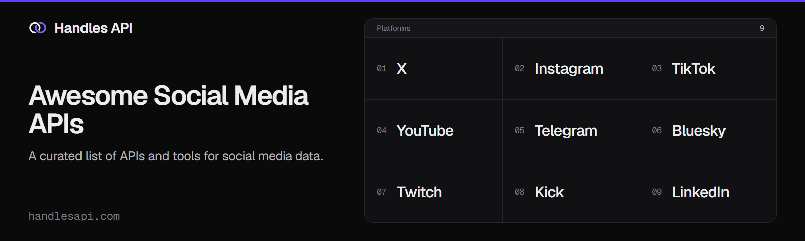

# Awesome Social Media APIs

A curated, neutral list of APIs, SDKs and tools for reading and building on social media data: the official platform APIs, the client libraries that wrap them, third-party data APIs, and the standards around them. Entries are listed alphabetically inside each section. A link is here because it is useful, not because it pays.

The list is maintained by the team behind [Handles API](https://handlesapi.com), which is listed in the third-party section like every other provider, plus once for its open-source MCP setup. See [CONTRIBUTING.md](CONTRIBUTING.md) to add or fix an entry.

## Contents

- [Official platform APIs](#official-platform-apis)
- [Client libraries and SDKs](#client-libraries-and-sdks)
- [Third-party social data APIs](#third-party-social-data-apis)
- [MCP and AI assistants](#mcp-and-ai-assistants)
- [Specs and standards](#specs-and-standards)
- [Analytics and reference tools](#analytics-and-reference-tools)

## Official platform APIs

Direct from the platform. Read each one's access rules and rate limits before building on it.

- [Bluesky and the AT Protocol](https://docs.bsky.app/) - open social protocol with a public API for posts, profiles and feeds.
- [Discord Developer Portal](https://docs.discord.com/developers/intro) - bots, OAuth2 and the REST/Gateway APIs.
- [Facebook Graph API](https://developers.facebook.com/docs/graph-api) - pages, groups and ads data for apps with review.
- [Instagram Platform](https://developers.facebook.com/documentation/instagram-platform) - Instagram API with Instagram Login and the Graph API for professional accounts.
- [Kick Developer Docs](https://docs.kick.com/) - Kick's public API for channels, chat and livestreams.
- [LinkedIn API documentation](https://learn.microsoft.com/en-us/linkedin/) - Microsoft Learn docs for LinkedIn's partner programs.
- [Mastodon API](https://docs.joinmastodon.org/api/) - REST API implemented by Mastodon and compatible servers.
- [Pinterest API](https://developers.pinterest.com/docs/api/v5/) - pins, boards and ads.
- [Reddit API](https://www.reddit.com/dev/api/) - the Data API for posts, comments and subreddits.
- [Telegram Bot API](https://core.telegram.org/bots/api) - HTTP interface for bots.
- [Telegram TDLib](https://core.telegram.org/tdlib) - the full client library behind Telegram apps.
- [Threads API](https://developers.facebook.com/documentation/threads) - publish and read Threads content.
- [TikTok for Developers](https://developers.tiktok.com/) - Login Kit, Display API and Content Posting API.
- [Twitch API](https://dev.twitch.tv/docs/api/) - Helix REST API and EventSub for streams, users and chat.
- [X API](https://docs.x.com/x-api/introduction) - X (Twitter) API v2 documentation.
- [YouTube Data API](https://developers.google.com/youtube/v3) - channels, videos, playlists and comments.

## Client libraries and SDKs

Open-source wrappers. Each talks to the platform's own API unless stated otherwise.

- [atproto (TypeScript)](https://github.com/bluesky-social/atproto) - the reference AT Protocol implementation and `@atproto/api` client.
- [atproto (Python)](https://github.com/MarshalX/atproto) - Python SDK for the AT Protocol.
- [google-api-python-client](https://github.com/googleapis/google-api-python-client) - Google's Python client, including the YouTube Data API.
- [grammY](https://github.com/grammyjs/grammY) - Telegram Bot framework for TypeScript.
- [Mastodon.py](https://github.com/halcy/Mastodon.py) - Python wrapper for the Mastodon API.
- [PRAW](https://github.com/praw-dev/praw) - the Python Reddit API Wrapper.
- [python-telegram-bot](https://github.com/python-telegram-bot/python-telegram-bot) - Python wrapper for the Telegram Bot API.
- [Telethon](https://github.com/LonamiWebs/Telethon) - Python client for Telegram's MTProto API.
- [Tweepy](https://github.com/tweepy/tweepy) - Python library for the X API.
- [TwitchIO](https://github.com/PythonistaGuild/TwitchIO) - Python library for Twitch chat and the Helix API.
- [twitter-api-v2](https://github.com/PLhery/node-twitter-api-v2) - TypeScript client for the X API v2.
- [Twurple](https://github.com/twurple/twurple) - TypeScript libraries for the Twitch API and chat.

## Third-party social data APIs

Hosted services that return public social data in a normalised shape, without you running scrapers. They differ in coverage, pricing model (catalog or live reads) and terms; compare before you commit.

- [Bright Data](https://brightdata.com/) - web data platform with social media datasets and scrapers.
- [Data365](https://data365.co/) - social media data API for several platforms.
- [EnsembleData](https://ensembledata.com/) - API for TikTok, Instagram, YouTube and other platforms.
- [Groundsocial](https://groundsocial.dev/) - REST and hosted MCP API for public data from 77 platforms (Reddit, X, TikTok, Instagram, YouTube, LinkedIn, Bluesky, Google and more), returned in each platform's own JSON shape; OpenAPI spec.
- [Handles API](https://handlesapi.com/) - REST and MCP API for public data from X, Instagram, TikTok, YouTube, Telegram, Bluesky, Twitch, Kick and LinkedIn companies; OpenAPI spec and SDKs on [GitHub](https://github.com/handlesapi).
- [HikerAPI](https://hikerapi.com/) - Instagram data API.
- [SocialData.tools](https://socialdata.tools/) - X (Twitter) data API.

## MCP and AI assistants

- [Handles API MCP server](https://github.com/handlesapi/mcp) - setup for Claude, Cursor and VS Code against a hosted social data MCP server.
- [Model Context Protocol](https://modelcontextprotocol.io/) - the open standard for connecting assistants to tools and data.
- [MCP reference servers](https://github.com/modelcontextprotocol/servers) - official collection of example and reference servers.

## Specs and standards

- [ActivityPub](https://www.w3.org/TR/activitypub/) - W3C protocol behind Mastodon and the fediverse.
- [OpenAPI Specification](https://spec.openapis.org/oas/latest.html) - the description format most REST APIs here publish.
- [openapi-typescript](https://github.com/openapi-ts/openapi-typescript) - generate TypeScript types from an OpenAPI document.
- [openapi-python-client](https://github.com/openapi-generators/openapi-python-client) - generate a Python client from an OpenAPI document.
- [OpenAPI Generator](https://github.com/OpenAPITools/openapi-generator) - client and server generators for dozens of languages.

## Analytics and reference tools

- [Social Blade](https://socialblade.com/) - public statistics and rankings for YouTube, Twitch, Instagram and more.
- [yt-dlp](https://github.com/yt-dlp/yt-dlp) - command-line downloader for video platforms; check each site's terms before use.

## License

[MIT](LICENSE). Product names belong to their owners. Inclusion is not an endorsement, and the maintainers are not affiliated with the services listed other than Handles API.
